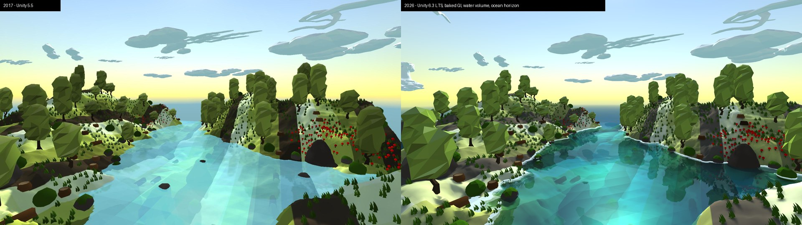
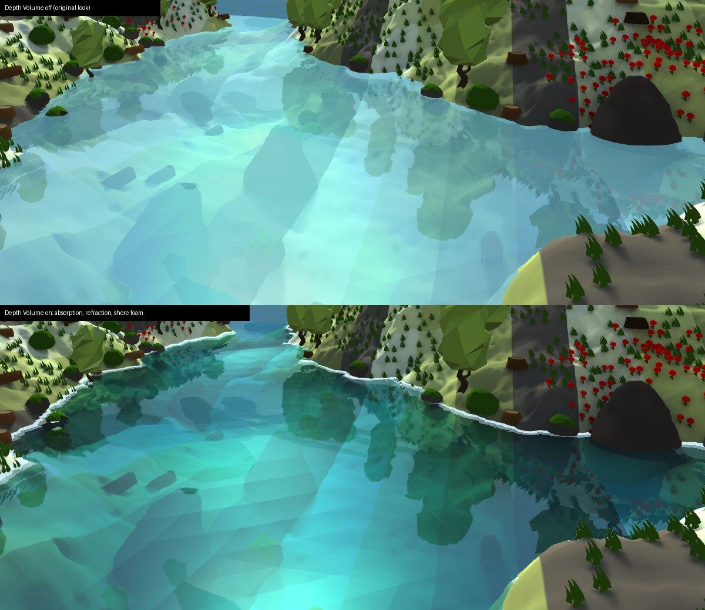

# LowPolyWater

Stylised low poly water for Unity's Built-in Render Pipeline. Waves are a sum of sines or Gerstner waves displaced on the GPU. Flat shading gives every triangle its own facet. The water has volume: it tints, absorbs and refracts the terrain under it, and draws a foam line where it meets the shore. Past the edge of the mesh, the skybox carries the sea on to the horizon. The demo island has baked soft shadows and global illumination, and its trees and grass sway in the wind.


## Then and now

The project started in 2017 on Unity 5.5 ([short video](https://imgur.com/U7PyrRZ)). It now runs on Unity 6.3 LTS, with the same camera angle and sun:



## Features

- **Two wave models**, chosen per `SineWaves` asset:
  - *Sum of sines* with crest sharpening, the original look ([GPU Gems, ch. 1](https://developer.nvidia.com/gpugems/gpugems/part-i-natural-effects/chapter-1-effective-water-simulation-physical-models)).
  - *Gerstner*: vertices also move sideways, giving pointed crests and wide troughs. Steepness is normalised per wave so the summed crests never loop over.
- **Flat shading without a geometry shader.** The facet normal comes from the screen-space derivatives of the displaced position, so it runs on every graphics API, including Metal and mobile.
- **Depth volume.** The shader reads the camera depth texture to measure how much water lies along each view ray:
  - Beer–Lambert absorption per channel: clear shallows over the riverbed, blue depths.
  - Refraction of the scene below, bent along the facet normal, which never pulls in objects in front of the water.
  - A banded shore foam line where the water depth goes to zero.
- **Planar reflections** that follow the camera's resolution, with a disturbance from the wave facets.
- **Specular** Blinn-Phong highlight with Schlick's Fresnel.
- **Ocean to the horizon.** The `LowPolyWater/Skybox Ocean` skybox intersects each view ray below the horizon with an infinite plane at the water level, so the sea lines up with the water mesh in perspective. Near the mesh it takes the river's deep colour and reflectivity; further out, Fresnel turns it into a reflection of the sky that meets the sky at the horizon. Its low poly facets fade out before they would shimmer.



## Requirements

- Unity **6000.3 LTS** (6000.3.28f1 or later)
- Built-in Render Pipeline, Forward rendering

## Getting started

1. Open the project folder in Unity Hub with Unity 6000.3.
2. Open `Assets/Demo/WaterTest2.unity`, the island and river from the screenshots, and press Play.
3. Fly around: mouse to look, WASD to move, Q/E to go up/down, Shift to go fast, Ctrl to go slow, End to lock or free the cursor.

`Assets/Demo/WaterTest.unity` is a bare wave test scene: two open-water tiles, one with each material setup.

## Using the water

1. Drop `Assets/Prefabs/LowPolyWater.prefab` into a scene. It holds the `LowPolyWater` and `LowPolyWaterReflection` components.
2. Create a wave setup with **Assets > Create > Custom > Sine Waves**, or start from one in `Assets/SineWaves/`, and assign it to the `LowPolyWater` component.
3. Use **Subdivide Mesh** on the component for smaller facets.
4. Keep the water on the **Water** layer: the reflection camera skips that layer.

### Sine Waves asset

| Field | Meaning |
| --- | --- |
| Model | `SumOfSines` (the original look) or `Gerstner` |
| Steepness | Gerstner only. 0 = rolling sines, 1 = crests about to loop over |
| Timescale | Global animation speed |
| Amplitude | Wave height |
| Wave Length | Distance between crests |
| Speed | Crest speed along the travel direction |
| Travel Angle | Direction of travel in degrees |
| Sharpness | Sum of sines only: crest sharpening exponent |

Up to 8 waves. Tick **Update Material Per Frame** on the component to see edits to the asset live.

### Material (`LowPolyWater/Transparent`)

| Property | Meaning |
| --- | --- |
| Albedo, Albedo Color | Surface colour. Alpha is the opacity when Depth Volume is off |
| Specular Color, Shininess, Fresnel Power | Sun highlight |
| Reflectivity, Reflection Disturbance | Planar reflection mix, and how much the facets bend it |
| Depth Volume | Turns depth tinting, absorption, refraction and foam on |
| Deep Color | Colour the water scatters where it is deep |
| Absorption per Unit (RGB) | How fast each channel fades with depth. Red highest keeps shallows clear and depths blue |
| Refraction | How far the facets bend the view of what is below |
| Foam Color, Foam Depth, Foam Bands | Shore foam colour (alpha is strength), the water depth it fades out at, and its number of hard steps |

## Wind

A `LowPolyWind` component (on the demo's **Wind** object) sets a global wind: direction, strength, and gust fronts that roll downwind across the island.

- `LowPolyWater/Foliage` bends trees, bushes, grass and flowers about their base. The sway grows with the square of the height, so roots stay put and tops travel furthest; leaves also flutter. **Wind Bend** sets how much each material bends.
- `LowPolyWater/Terrain` makes the baked tree shadows sway too. Each terrain vertex shifts its lightmap lookup by the sway of the canopy that shades it, found by stepping toward the sun.

**Tools > Low Poly Water > Configure Wind** sets this up on the demo scene: the wind object, the foliage and terrain materials, and terrain trees drawn as meshes so they can bend.

## Lighting

The demo island is lit by a Mixed directional sun in **Shadowmask** mode:

- The terrain carries baked lightmaps with soft area-light shadows (4° sun disc), three indirect bounces and ambient occlusion from the GPU Progressive Lightmapper.
- The water, trees and props get the sun in realtime and the bounce light from a light probe grid.
- The clouds are lit by the sky only.
- The scene keeps the procedural sky for ambient light, reflections and the bake. Only the main camera draws the ocean skybox, from its `Skybox` component; the water's reflection camera copies it.

Everything is set up by an editor command, so the bake can be reproduced or tweaked:

- **Tools > Low Poly Water > Configure Demo Lighting** applies the lighting settings, light, terrain and probe setup to the open scene.
- **Tools > Low Poly Water > Bake Demo Lighting** bakes and saves the scene.
- **Tools > Low Poly Water > Bake Ocean Skybox** captures the procedural sky into a cubemap and builds the ocean skybox from the water: its level, colour, reflectivity and facet size. Run it again after a bake, so the ocean picks up the baked light probes.
- **Tools > Low Poly Water > Capture Main Camera** writes `Captures/capture.png` at 1920×1080.

The same commands run from the command line, for example to re-bake and capture the README shot:

```bash
Unity -batchmode -quit -projectPath . -executeMethod DemoTools.ConfigureAndBakeFromCommandLine -out Captures/baked.png
```

`ConfigureAndBakeFromCommandLine` runs Configure Wind, Bake Ocean Skybox, Configure Demo Lighting and Bake Demo Lighting, then bakes the ocean skybox again.

The README animation is a numbered frame sequence on a fixed clock for the waves and the wind, encoded with ffmpeg:

```bash
Unity -batchmode -quit -projectPath . -executeMethod DemoTools.CaptureSequenceFromCommandLine -frames 112 -fps 24 -out Captures/sequence/frame
```

The last 16 frames are crossfaded into the first ones so the GIF loops without a jump.

## Third-party content

The demo scene uses free Asset Store packs, kept under `Assets/Demo/External/`: *3LE Low Poly Cloud Pack*, *Low Poly Styled Trees*, and a set of low poly nature props. `ExtendedFlycam`, `MeshHelper`, `NoSharedVertices` and `InspectorButton` are adapted community scripts. `ExtendedFlycam` credits its source in its header.

## License

[MIT](LICENSE)
