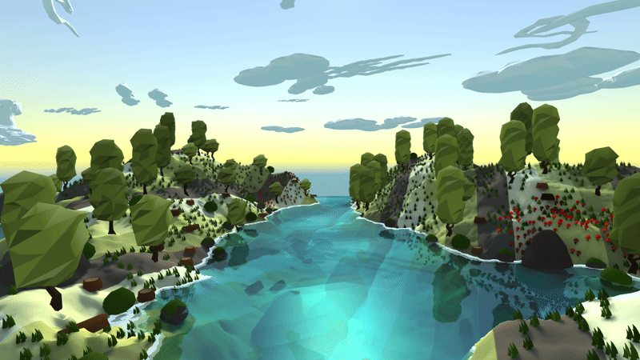

# LowPolyWater

Stylised low poly water for Unity's Built-in Render Pipeline. Waves are displaced on the GPU, and flat shading gives every triangle its own facet. The water tints, absorbs and refracts what lies beneath it and draws foam along the shore. Past the edge of the mesh, a skybox carries the sea on to the horizon.

## Features

- **Sum of sines or Gerstner waves**, chosen per `SineWaves` asset.
- **Flat shading without a geometry shader**, so it runs on every graphics API, including Metal and mobile.
- **Depth volume:** per-channel absorption, refraction of the scene below, and a banded shore foam line.
- **Planar reflections** and a Blinn-Phong highlight with Fresnel.
- **Ocean skybox** that lines up with the water mesh in perspective and meets the sky at the horizon.
- **Wind** for trees, grass and flowers, with baked shadows that sway along with them.

## Requirements

- Unity **6000.3 LTS** (6000.3.28f1 or later)
- Built-in Render Pipeline, Forward rendering

## Getting started

1. Open the project in Unity 6000.3.
2. Open `Assets/Demo/WaterTest2.unity` and press Play.
3. Fly around: mouse to look, WASD to move, Q/E to go up/down, Shift to go fast, Ctrl to go slow, End to lock or free the cursor.

`Assets/Demo/WaterTest.unity` is a bare wave test scene.

## Using the water

1. Drop `Assets/Prefabs/LowPolyWater.prefab` into a scene.
2. Create a wave setup with **Assets > Create > Custom > Sine Waves**, or start from one in `Assets/SineWaves/`, and assign it to the `LowPolyWater` component.
3. Use **Subdivide Mesh** on the component for smaller facets.
4. Keep the water on the **Water** layer: the reflection camera skips that layer.

### Sine Waves asset

| Field | Meaning |
| --- | --- |
| Model | `SumOfSines` or `Gerstner` |
| Steepness | Gerstner only. 0 = rolling sines, 1 = crests about to loop over |
| Timescale | Global animation speed |
| Amplitude | Wave height |
| Wave Length | Distance between crests |
| Speed | Crest speed along the travel direction |
| Travel Angle | Direction of travel in degrees |
| Sharpness | Sum of sines only: crest sharpening exponent |

Up to 8 waves. Tick **Update Material Per Frame** on the component to see edits to the asset live.

### Material (`LowPolyWater/Transparent`)

| Property | Meaning |
| --- | --- |
| Albedo, Albedo Color | Surface colour. Alpha is the opacity when Depth Volume is off |
| Specular Color, Shininess, Fresnel Power | Sun highlight |
| Reflectivity, Reflection Disturbance | Planar reflection mix, and how much the facets bend it |
| Depth Volume | Turns depth tinting, absorption, refraction and foam on |
| Deep Color | Colour of deep water |
| Absorption per Unit (RGB) | How fast each channel fades with depth |
| Refraction | How far the facets bend the view of what is below |
| Foam Color, Foam Depth, Foam Bands | Shore foam colour (alpha is strength), the depth it fades out at, and its number of steps |

## Ocean and wind

- **Ocean:** put a `LowPolyWater/Skybox Ocean` material on the camera's `Skybox` component. **Tools > Low Poly Water > Bake Ocean Skybox** builds one for the open scene from its sky and water.
- **Wind:** add a `LowPolyWind` component to the scene and use `LowPolyWater/Foliage` on plants. **Wind Bend** on each material sets how far it bends. `LowPolyWater/Terrain` makes baked shadows sway with the plants.

## Third-party content

The demo scene uses free Asset Store packs, kept under `Assets/Demo/External/`: *3LE Low Poly Cloud Pack*, *Low Poly Styled Trees*, and a set of low poly nature props. `ExtendedFlycam`, `MeshHelper`, `NoSharedVertices` and `InspectorButton` are adapted community scripts.

## License

[MIT](LICENSE)
